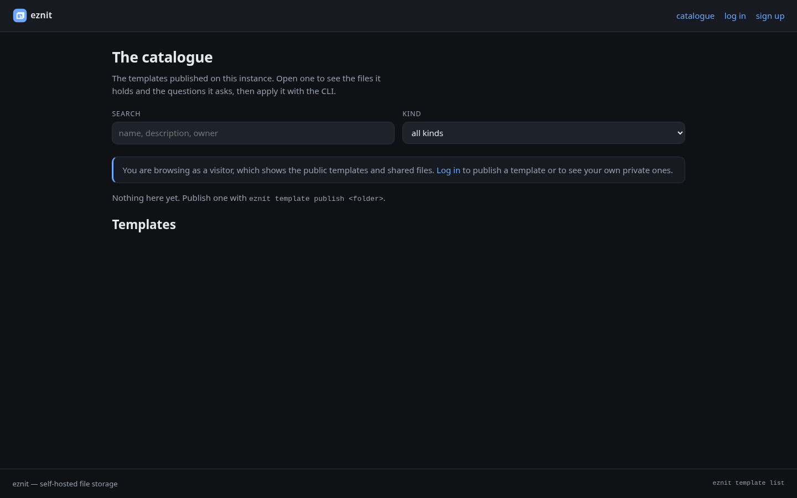
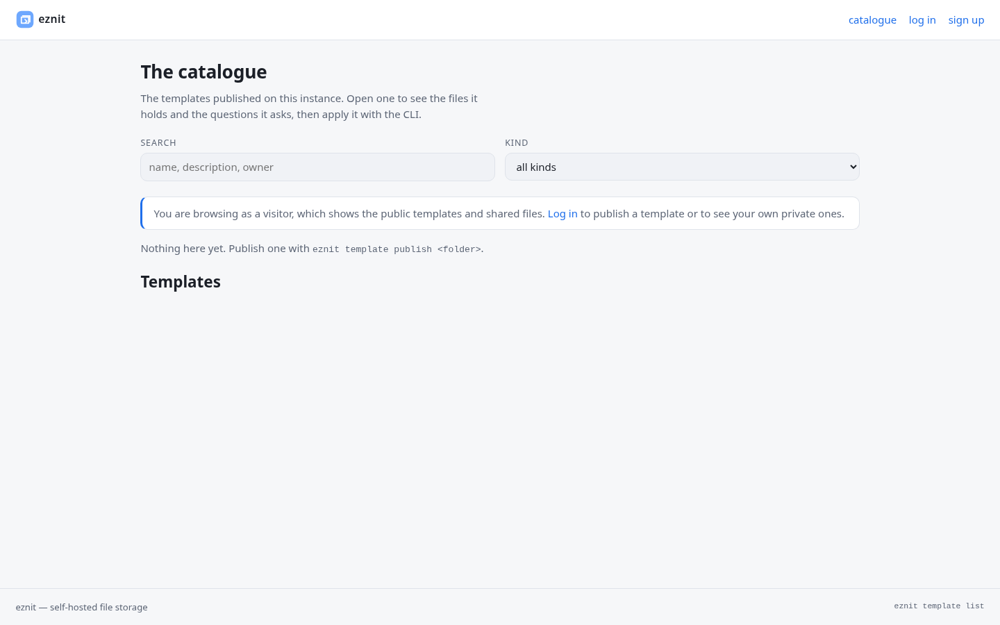

<div align="center">


# eznit

**Your project's setup, in one place you host.**

Templates, scripts and files you can pull onto any machine — self-hosted, no
subscription, no third party.

[](https://github.com/fiwon123/eznit/releases)
[](LICENSE)
[](https://github.com/fiwon123/eznit/releases)
[](https://github.com/fiwon123/eznit/actions/workflows/ci.go.yml)
[](https://github.com/fiwon123/eznit)

</div>

## ✨ What it is

- **One place for the files a project needs.** Agent instructions, editor rules,
  skills, scripts, any text or binary file, in any folder shape you like.
- **Publish once, apply anywhere.** A folder becomes a *template*: the next
  machine, or the next project, gets `eznit template apply <id>` instead of a
  retyped setup.
- **With or without AI.** Built-in starters for opencode, Codex, Copilot, Cursor
  and Windsurf; the same folder holds plain shell and editor configuration.
- **Yours.** Bytes live on your disk, indexed in your own PostgreSQL. No
  subscription and no third-party account.
- **One command to try.** `make setup && make up` needs only Docker.

> **Pre-1.0 and unhardened.** Read [Security status](#-security-status) before
> exposing this anywhere but `localhost`.

## 🚀 Quick start

```sh
make setup && make up     # Docker: API :4000, UI :5173, PostgreSQL, migrations
```

| What | Where |
| --- | --- |
| Web UI | http://localhost:5173 |
| API | http://localhost:4000 |
| API reference (Swagger UI) | http://localhost:5173/docs |

Uploaded bytes live on the `api-data` volume, so they survive
`docker compose down` (`down -v` removes them too).

### 📄 Your first template

The CLI is a separate binary: `make build_cli` (Go only) writes
`build/cli/linux/eznit`, or download one from
[Releases](https://github.com/fiwon123/eznit/releases).

```sh
./build/cli/linux/eznit template init --kind opencode --target ./demo  # no server needed
./build/cli/linux/eznit signup                                        # first account is the admin
./build/cli/linux/eznit template publish ./demo --public
./build/cli/linux/eznit template list                                 # note the id
./build/cli/linux/eznit template apply <id> --target ../another-project
./build/cli/linux/eznit template export <id> -o setup.eznit          # one file…
./build/cli/linux/eznit template apply --from-file setup.eznit        # …on a machine with no server
```

The core commands prompt for what they need. `template init` is the offline
path: it writes a starter into a folder with no server and no account. Full
flags: [CLI Reference](https://github.com/fiwon123/eznit/wiki/CLI-Reference).

### 🌐 Web UI

| Dark | Light |
| --- | --- |
|  |  |

Sign up or log in on the page, or paste the token from `eznit login` into
`localStorage` as `eznit.token`. The full set of screenshots is under
[`docs/screenshots`](docs/screenshots).

## 🧩 What you can keep

| Keep | Commands | Travels as |
| --- | --- | --- |
| **Files** | `upload`, `list`, `download`, `delete`, `share` | bytes on your disk, indexed in PostgreSQL |
| **Templates** | `template publish`, `list`, `show`, `apply`, `export`, `init` | a folder: text, binary, variables, commands |
| **Commands** | `command add`, `list`, `show`, `remove`, `import`, `export` | a script kept once and pulled into templates by id; a crower pack imports/exports them |
| **Repositories** | `repo auth`, `list`, `clone` (GitHub, GitLab, Bitbucket) | a clone; the token stays on your machine |

A template may hold anything: `AGENTS.md`, `.opencode/agents/`, a `SKILL.md`,
`.cursor/rules/`, a PowerShell profile, a `Makefile`. Values like
`{{PROJECT_NAME}}` are asked on the machine that writes the files and are never
sent to the server.

## 💻 Terminals, shells and editors

`eznit template init --kind` writes a starter for the terminal you use:

| Kind | Starter writes |
| --- | --- |
| `opencode` | `AGENTS.md` + `.opencode/agents/{build,plan,reviewer}.md` |
| `codex` | `AGENTS.md` |
| `copilot` | `AGENTS.md` + `.github/copilot-instructions.md` |
| `cursor` | `AGENTS.md` + `.cursor/rules/project.mdc` |
| `windsurf` | `AGENTS.md` + `.windsurf/rules/project.md` |
| `generic` | `AGENTS.md` |
| `bash` | `shell/bashrc.sh` |
| `zsh` | `shell/zshrc.sh` |
| `fish` | `shell/config.fish` |
| `powershell` | `shell/profile.ps1` |

The shell starters are commented snippets: source the file from your shell's
rc/profile and uncomment the examples you want. Applying a template never edits
a file in your home directory unless you point `--target` there.

## 📦 Download

| Platform | Archive |
| --- | --- |
| 🐧 Linux amd64 | `eznit_<tag>_linux_amd64.tar.gz` |
| 🐧 Linux arm64 | `eznit_<tag>_linux_arm64.tar.gz` |
| 🪟 Windows amd64 | `eznit_<tag>_windows_amd64.zip` |
| 🪟 Windows arm64 | `eznit_<tag>_windows_arm64.zip` |
| 🍎 macOS amd64 | `eznit_<tag>_darwin_amd64.tar.gz` |
| 🍎 macOS arm64 | `eznit_<tag>_darwin_arm64.tar.gz` |

One download holds the whole product: `eznit` and `ez` (the CLI), `eznit-server`
(the API), `eznit-gui` (the desktop window: **Files** and **Templates** are
clients of an API, **Server** runs one beside it), the migrations,
`docker-compose.yml` and the example configuration.
`RUNNING.md` says what runs from it and what does not. Verify a download against
`checksums.txt` from the release page.

### 🪟 From a download, in one minute

```sh
sha256sum -c checksums.txt --ignore-missing   # the archive you downloaded
tar -xzf eznit_<tag>_linux_amd64.tar.gz       # or unzip on Windows
cd eznit_<tag>_linux_amd64
./eznit-gui                                    # the window, from inside the bundle
```

Run the window **from inside the extracted folder**: the Server tab looks for
`eznit-server` beside it. The window is a client first — type any eznit API into the **Files**
header and **Connect** — and a host second: the Server tab runs the server in
that folder. Its first run is **Server → Configuration → Create .env → set the
database password → Save → Start**: **Start** brings up the database and applies
the migrations through the folder's own Compose services when nothing answers, so
the database does not need a terminal step. Without the window, `./eznit` is the
CLI and `./eznit-server` is the API; `RUNNING.md` in the folder has the rest.

## 🔒 Security status

This is a self-hosted tool, and it is not hardened. What is true today:

1. **Files are stored unencrypted** on the server's disk. Do not put this on a
   public interface as it stands — `localhost` or a VPN you control.
2. **The first account is the admin.** It is the only one that may list, update
   or delete other accounts; no route grants the flag.
3. **Auth is rate-limited** per IP and per address (`429` + `Retry-After`).
   Signup and login do not reveal whether an address has an account; passwords
   are bcrypt; session tokens are random and expire.
4. **Tokens stay on the CLI machine.** The session token and the git-host token
   live in `~/.eznit/config.json` (mode `0600`); the eznit API never sees the
   host token.

The full list of what is deferred is on the
[roadmap board](https://github.com/users/fiwon123/projects/12).

## 📚 Documentation

| I want to… | Read |
| --- | --- |
| try it in five minutes | [Getting Started](https://github.com/fiwon123/eznit/wiki/Getting-Started) |
| publish and apply a template | [Templates and skills](https://github.com/fiwon123/eznit/wiki/Templates-and-Skills) |
| look up a command or flag | [CLI Reference](https://github.com/fiwon123/eznit/wiki/CLI-Reference) |
| configure every variable and secret | [Configuration](https://github.com/fiwon123/eznit/wiki/Configuration) |
| know what runs on which OS or shell | [Platforms and shells](https://github.com/fiwon123/eznit/wiki/Platforms-and-Shells) |
| see what is planned | [Direction](https://github.com/fiwon123/eznit/wiki/Direction) |
| develop or build a release | [Development](https://github.com/fiwon123/eznit/wiki/Development) · [Releases](https://github.com/fiwon123/eznit/wiki/Releases) |
| fix an error | [Troubleshooting](https://github.com/fiwon123/eznit/wiki/Troubleshooting) |

In the repository: [ARCHITECTURE.md](ARCHITECTURE.md) is the map of the request
path and where a change belongs; [CONTRIBUTING.md](CONTRIBUTING.md) is how to
send one. The wiki's source is `docs/wiki/` — edit it through a pull request, or
the next sync overwrites it.

## ⚠️ What is not proven

This project says what it verified.

- **No test sends a request through the whole stack.** The router is tested with
  no database, and the repositories are tested against a real PostgreSQL; no
  test starts the API and makes an HTTP call that reaches a query.
- **The Windows server binary is built, never started.** CI smoke-tests the
  Windows CLI; the server and the Compose stack are not run on Windows.
- **The ARM64 binaries are built, never executed** on ARM hardware, and the
  macOS archives are cross-compiled on Linux and never started on a Mac.
- **The browser UI has no automated test**; the screenshots are captured by
  hand.
- **The desktop window is compiled, never opened, by any gate.** CI builds it
  with `-tags fyne`; no test starts a window, and the Windows smoke test only
  runs `--help`.
- **The updater has not been run against the real GitHub release API**, and a
  Windows self-replace (the rename dance) has not been exercised.

Running the untested parts and saying what happened is the most useful
contribution right now — see [CONTRIBUTING.md](CONTRIBUTING.md).

## 🤝 Contributing

Issues and pull requests are welcome: open an issue first, branch from `dev`,
run `make check` (and `make web_check` for UI changes), and say in the pull
request what ran and what did not. The full rules are in
[CONTRIBUTING.md](CONTRIBUTING.md).

This project is developed with an AI agent. The review bar is the same: judge by
tests and evidence, not by who wrote it.

## 📄 License

MIT — see [LICENSE](LICENSE).
