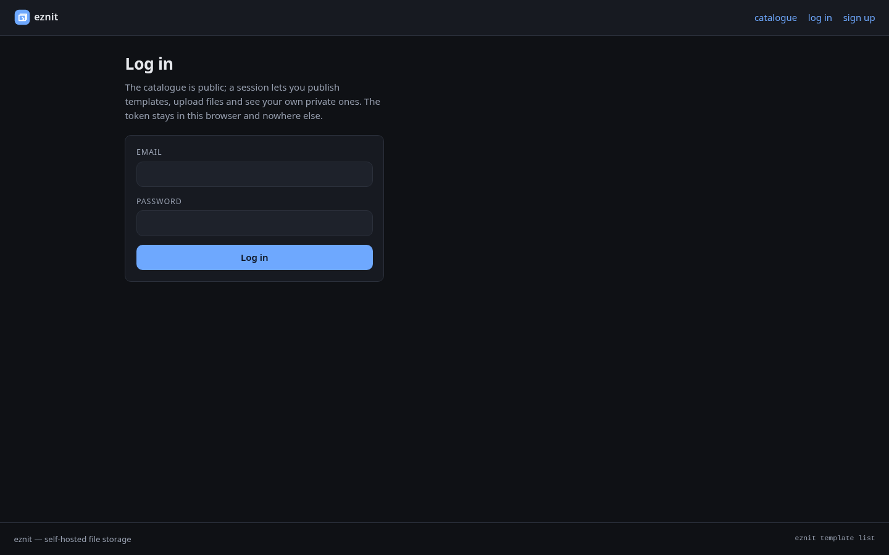
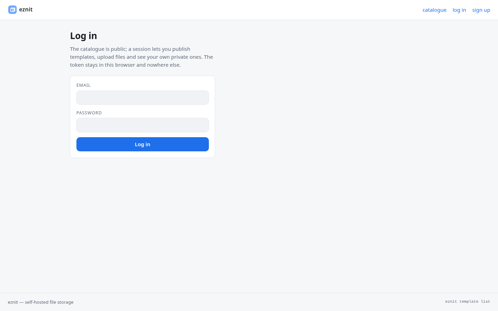
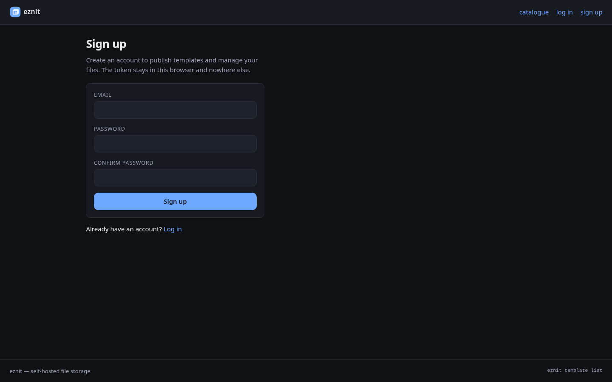
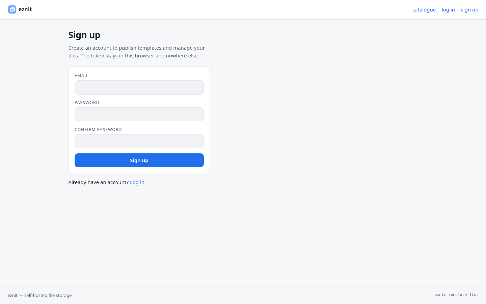

<div align="center">


# eznit

**Self-hosted file storage you control**

A Go API, CLI client, and web UI for uploading, listing, and retrieving your own files, backed by PostgreSQL.

[](LICENSE)
[](go.mod)
[](https://github.com/fiwon123/eznit/actions/workflows/ci.go.yml)
[](https://github.com/fiwon123/eznit)

</div>

## Why eznit

- **Yours.** File bytes live on your disk, indexed in your own PostgreSQL. No
  subscription, no third-party account.
- **No browser needed.** The CLI puts a file back out with one command; the web UI
  is there when you want it. The API and the CLI are the whole product.
- **One stack.** `make setup && make up` runs the API, the UI, PostgreSQL and the
  migrations on a machine with Docker.

> **Pre-1.0 and unhardened.** Read [Security status](#security-status) before
> exposing this anywhere but `localhost`.

Supported platforms: Linux, macOS and Windows. The product stack runs on Docker;
the CLI and the API are pure Go.

## Quick start

Two local files come first — the configuration and the database secret. Both are
gitignored, and `make setup` creates them from the committed examples:

```sh
make setup
make up             # or: docker compose up
```

When it returns:

| What | Where |
| --- | --- |
| Web UI | http://localhost:5173 |
| API | http://localhost:4000 |
| Docs (Swagger UI) | http://localhost:4000/docs |

Uploaded bytes live on the `api-data` volume, so they survive `docker compose down`
(use `docker compose down -v` to remove them too).

### Your first file

```sh
make build
./build/cli/eznit signup     # Enter Email / Password / Confirm
./build/cli/eznit login      # stores a session token in ~/.eznit/config.json (0600)
./build/cli/eznit upload     # file path: ./notes.txt
./build/cli/eznit list       # the files you own; note an id
./build/cli/eznit download   # id file: <id>  / destination folder path: ./out
```

The core commands prompt for what they need. Need Go or Node on the host? You do
not — the images build the UI. Want the source loop with live reload? See
[Getting Started](https://github.com/fiwon123/eznit/wiki/Getting-Started) and
[Development](https://github.com/fiwon123/eznit/wiki/Development).

## Install options

| Path | For | Start |
| --- | --- | --- |
| Compose stack (source) | trying it, running it | `make setup && make up` |
| Release bundle | a machine with no source | unpack, `docker compose up db migrate`, run `eznit-server` |
| Host toolchain | development | `make run_api` + `make web_dev` |

See [Getting Started](https://github.com/fiwon123/eznit/wiki/Getting-Started) for
each, including the Windows and no-Make paths.

## Usage

### CLI

| Command | What it does |
| --- | --- |
| `eznit signup` / `login` / `logout` | Create an account, start a session, end it |
| `eznit upload` | Upload a file (`--update <id>` replaces one) |
| `eznit list` | List your own files (`--me` is the same list) |
| `eznit download` | Download one of your own files by id |
| `eznit delete` | Delete a file |
| `eznit share` / `unshare` | Make a file public to the instance, or private again |

Templates, the command library and git hosts are covered in the
[CLI Reference](https://github.com/fiwon123/eznit/wiki/CLI-Reference):

```sh
eznit template publish <folder>   # publish a folder as a template
eznit template list               # the catalogue
eznit command add <file>          # keep a script, pull it into templates by id
eznit repo clone <owner/name>     # clone a repo the stored GitHub token can reach
```

A session is required for anything that touches your own rows; `signup`, `login`
and the public reads (catalogue, shared files) are the exceptions.

### Web UI

| | Dark | Light |
|---|---|---|
| **Catalogue** |  |  |
| **Log in** |  |  |
| **Sign up** |  |  |

Captured with `make screenshots` against a running stack. Sign up or log in through
the page, or paste the token from `eznit login` into `localStorage` as
`eznit.token`. The UI lives in `web/` and is served two ways: from disk
(`web/dist`) by the API, and embedded in the released binaries.

### API reference

Every `/v1` operation is described in one OpenAPI 3.1 document, served by the API
itself:

- **`http://localhost:4000/docs`** — Swagger UI, with an **Authorize** button and
  "Try it out" on every operation.
- **`http://localhost:4000/v1/openapi.yaml`** — the document, committed at
  `internal/platform/openapi/openapi.yaml`.
- **`http://localhost:4000/v1/openapi.json`** — the same document as JSON.

The UI assets are embedded in the binary, so the reference works with no internet
access, and none of these routes needs a session. A test fails when the document
and the router disagree.

## Security status

This is a self-hosted tool, and it is not hardened. What is true today:

- **Coverage is partial.** The API domains, the middleware, the CLI, the web UI and
  the OpenAPI document have tests; `cmd/cli`, `pkg/errors`, `pkg/logger` and
  `pkg/types` have none. A green `make check` means "it builds and the tested
  packages passed" — not "it works".
- **The first account is the admin.** It is the only one that may list, update or
  delete other accounts. Promote another with
  `UPDATE users SET is_admin = true WHERE email = ...`.
- Files are stored unencrypted on the server's disk.
- There is no rate limiting on `signup` or `login`.
- Signup and login do not say whether an address has an account: a signup for a
  taken address answers like a new one, and a failed login is one generic `401`.
- Passwords are hashed (bcrypt); session tokens are random and stored with an
  expiry. CI runs a reachable-vulnerability scan (`govulncheck`); `make vuln` runs
  it locally.
- A git-host token stays in the CLI's own config file (mode 0600); the eznit API
  never sees it.

**Do not put this on a public interface as it stands.** It is fine on `localhost`,
or behind a VPN you control. Local secret files (`.env`, `.env.local`,
`secrets/db_password.txt`) must be mode `600` — see
[Configuration](https://github.com/fiwon123/eznit/wiki/Configuration).

The deferred hardening work is tracked on the
[roadmap board](https://github.com/users/fiwon123/projects/12).

## Documentation

| Page | What it covers |
| --- | --- |
| [Getting Started](https://github.com/fiwon123/eznit/wiki/Getting-Started) | Run the stack and put a file in and out |
| [CLI Reference](https://github.com/fiwon123/eznit/wiki/CLI-Reference) | Every command, flag and the config file |
| [Configuration](https://github.com/fiwon123/eznit/wiki/Configuration) | Every variable, secret and port |
| [Development](https://github.com/fiwon123/eznit/wiki/Development) | The dev loop, sandbox, migrations and the gates |
| [Troubleshooting](https://github.com/fiwon123/eznit/wiki/Troubleshooting) | The errors you are likely to hit |
| [Releases](https://github.com/fiwon123/eznit/wiki/Releases) | How a release is cut and what the archives hold |

In the repository: [ARCHITECTURE.md](ARCHITECTURE.md) is the map of the request
path, the data model and where a change belongs; [CONTRIBUTING.md](CONTRIBUTING.md)
is how to send a change. The wiki's source lives at `docs/wiki/` — edit it through
a pull request, not only in the wiki UI, or the next sync overwrites it.

## Repository layout

```
cmd/             the entrypoints: api, cli, gui
internal/domain/ one package per resource: users, sessions, files, templates
                 handler -> service -> repository, plus dto.go
internal/platform/ middleware (session guard), sql, webui (SPA), openapi
pkg/             logger, errors, http/json helpers, path helpers, types
db/migrations/   golang-migrate SQL, one up/down pair per change
web/             React + TypeScript UI; embeds into the api/gui binaries
```

The layering is strict: a handler decodes and writes, a service holds the rules, a
repository is the only place that speaks SQL.

## Contributing

Issues and pull requests are welcome. The short version: open an issue first,
branch from `dev`, run `make check` (and `make web_check` for UI changes), and say
in the pull request what ran and what did not. The full rules are in
[CONTRIBUTING.md](CONTRIBUTING.md).

This project is developed with an AI agent. The review bar is the same: judge by
tests and evidence, not by who wrote it.

## License

MIT — see [LICENSE](LICENSE).
